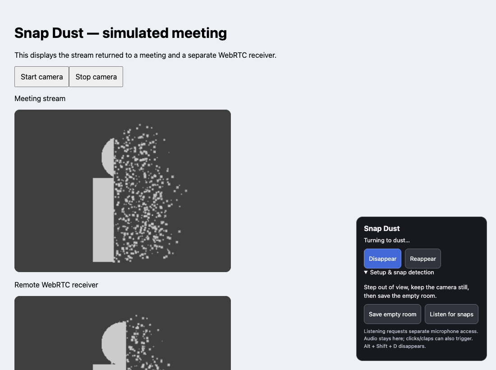

# Snap Dust Camera

**Snap. Dissolve into dust. Reappear when you're ready.**

A local-first Chrome Manifest V3 extension prototype for browser-meeting camera streams. No account, backend, runtime dependencies or build step required.

> **Prototype status:** verified with a synthetic camera and a separate local WebRTC receiver. Real Google Meet/Zoom Web calls and physical finger snaps are not yet verified. Browser meetings only; this is not a system-wide virtual webcam.



## Features

- Right-to-left dust dissolution with drifting, source-colored particles.
- Empty-room capture to leave a clean background after disappearing.
- Optional local microphone snap detection, plus a button and **Alt + Shift + D** shortcut.
- **Reappear** control to restore the live camera.
- Explicit per-site enablement; effects are off by default.
- Meeting audio passes through unchanged; no uploads or telemetry from this extension.

## How it works

A finger-snap-inspired camera disappearance effect: your silhouette freezes, breaks into drifting dust over about three seconds, and leaves the captured empty room behind. Reappear restores your live camera. This is original software inspired by the requested film effect, not an official Marvel product.

## Install

1. Open Chrome's Extensions page: `chrome://extensions`.
2. Enable **Developer mode**.
3. Download this repository using GitHub's **Code → Download ZIP** and extract it, or clone it. Click **Load unpacked** and select the extracted/cloned repository folder containing [manifest.json](manifest.json). There is no npm install or build step for using the extension.
4. Pin **Snap Dust Camera** from Chrome's extension menu.
5. Open your browser meeting site. Before joining, click the extension icon and **Enable here & reload**. Reloading a live meeting may disconnect you. The enable setting is saved per origin, not globally.
6. Turn on the camera through the meeting's controls. A **Snap Dust** panel should appear. If it does not, the meeting's capture path is not intercepted; do not assume others see an effect.
7. Keep the camera still, step completely out of view, and click **Save empty room**. You can ask someone else to click or use your mouse from outside the frame. Return to your normal position.
8. Click **Disappear**, press **Alt + Shift + D** while the meeting page is focused, or opt into **Listen for snaps** and allow the separate microphone request. Snap your fingers near the microphone.
9. Click **Reappear** to return. To disable the extension for the site, use the popup's **Disable here & reload** before your next meeting.

Confirm with another participant or a recording in a private test meeting before using it publicly. Turn off the meeting software's own background replacement/blur for the clearest effect.

## Scope and limitations

- Intended for **Chrome browser meetings**, including capture paths used by Google Meet and Zoom Web. **Actual Meet/Zoom compatibility is not yet verified.** It does not create a selectable OS virtual camera and cannot affect Zoom desktop, Teams desktop, FaceTime, native apps, or other browsers.
- It wraps `navigator.mediaDevices.getUserMedia` at document start and replaces newly requested camera video with a canvas video track. It does not change screen sharing (`getDisplayMedia`) or cameras acquired before installation/enabling. Reload after installing, updating or changing the site's enable setting.
- Both scripts are injected in frames, but enablement is scoped to the frame's origin. A camera acquired by a different-origin embedded frame, a worker, an extension-restricted site, a saved native API, or another capture mechanism may bypass the effect. Runtime changes in a meeting site can break interception.
- This prototype uses **clean-plate pixel differencing**, not an AI person mask. Camera movement, lighting/exposure shifts, shadows, other people and moving objects may become dust. Matching-background clothing may leave holes. While disappeared, the background is a **saved still image**, not a reconstructed live room.
- **Snap listening is an experimental high-frequency transient detector**, not finger-gesture recognition or a trained snap classifier. Clicks, claps, keyboard sounds and other loud transients may trigger it; soft snaps may be missed. A fixed threshold is used. The button and shortcut are reliable backups.
- Maximum output width is 960 pixels at a target 30 FPS with preserved source aspect ratio. A canvas track is not a complete drop-in hardware-camera emulation: camera capabilities, labels, constraint updates and cloned-track lifecycle behavior may differ. Sites relying on these need additional adapters/testing.
- Chrome may throttle/freeze background tabs. Keep the meeting foreground during the effect. Performance on low-power devices is unverified.
- No sound effect is inserted into the meeting audio. The real microphone can still transmit the audible snap normally according to the meeting's mute setting.
- No Chrome Web Store listing, signing, automatic update service or native-camera companion is included. Chrome 111+ is declared; execution was tested on the bundled Chromium used by Playwright, not every Chrome release.

## Privacy, permissions and lifecycle

No backend, telemetry, uploads, remote dependencies or model downloads. Camera frames, clean plate, particles and microphone samples remain in page memory. Only per-origin enable preferences and installation version are stored in extension-local storage. The page's own meeting service may transmit camera/audio normally; this extension does not alter that service's privacy policy.

The manifest injects into HTTPS sites and localhost, so Chrome may show a broad site-access warning. This supports arbitrary browser meeting domains; **effects are disabled by default** and require explicit per-origin opt-in. `storage` keeps those preferences. `activeTab` lets the popup read the current site's origin after you click the extension action. The extension never starts the camera by itself; the meeting requests it. Snap listening requests a separate microphone stream only after you click its control and releases it when listening stops or the last processed camera session closes. It analyzes audio without connecting it to speakers or replacing the meeting microphone.

Stopping the directly returned outgoing camera track stops its hidden source camera, clears its render timer and removes its panel. Page exit also disposes sessions. **Disappearing is not turning the camera off**: the source camera keeps running so you can reappear. Camera/microphone browser indicators are expected. Use the meeting's camera-off and microphone-mute controls when those devices must be stopped/muted.

This is a visual entertainment effect, **not privacy/redaction software**. The meeting page shares the MAIN execution world with the hook and can access/tamper with it or its same-window messages. Other capture paths and other apps are not blocked. Do not use disappearance as assurance that nobody can see or record you.

## Verification

[Smoke-test runner](tests/smoke.mjs) loads the actual unpacked extension in persistent headless Chromium with deterministic fake camera/audio devices. A [simulated meeting](tests/meeting.html) sends the returned tracks to a second WebRTC peer. Playwright is a development dependency only; the shipped extension has **no npm/runtime dependencies**.

With Node.js 22+ and npm, run from this repository's root:

```sh
npm ci
npm run test:setup
npm run check
npm test
```

The setup command downloads Playwright's Chromium browser. The tests never use your real webcam or microphone and need no other project from the original workspace.

Ten checks pass: audio retention; missing-plate guard; shortcut disappearance at a remote peer; reappearance; synthetic microphone transient triggering; independent listener shutdown; outgoing-track stop/UI cleanup; camera restart; disabled-origin passthrough; and no page errors. Synthetic audio tests establish the trigger pipeline, **not real finger-snap detection accuracy**. Camera restart/output cleanup checks do not establish every native indicator, permission-dialog or cloned-track path.

- [Recorded test results](artifacts/test-results.json)
- [Dust midpoint](artifacts/dust-midpoint.png)
- [Disappeared](artifacts/disappeared.png)
- [Visible again](artifacts/visible.png)

Still required: physical snap tests across microphones/noise levels, real Google Meet and Zoom Web calls with a remote viewer, camera switching and native permission denial/cancellation, tab suspension, multiple camera sessions, track clones, capability/constraint calls, low-power performance, keyboard conflicts and accessibility review. The popup's real toolbar permission interaction also needs a manual Chrome check; automated tests set the same origin preference through the extension's test worker.

## Files and references

- [Camera hook and local audio analysis](camera-bridge.js)
- [Isolated-world meeting controls](controls.js)
- [Popup](popup.html) and [popup logic](popup.js)
- [Installation metadata worker](background.js)
- [Development scripts and pinned test dependency](package.json)

## Troubleshooting

- **No floating panel:** enable the extension for the exact meeting origin, reload before joining, and restart the meeting camera. Some capture paths are unsupported.
- **Nothing happens when snapping:** allow the separate microphone request, move closer to the microphone, or use the Disappear button. The detector can miss real snaps.
- **Room or shadows dissolve:** save the empty room again with unchanged lighting and a fixed camera. Turn off the meeting's own virtual background.
- **Effect freezes:** keep the meeting tab foreground and avoid battery-saving/tab-suspension modes.
- **Other participants still see you:** stop the camera and test the capture path privately. Never use this effect as a privacy guarantee.

## Contributing and reporting issues

Bug reports should include your OS, Chrome version, browser meeting service, whether its own background effects are enabled, and steps to reproduce. Do not upload private meeting recordings, faces, microphone samples or credentials. Run the checks above before submitting changes. High-priority validation areas are real meeting compatibility, physical snap accuracy and camera-track lifecycle handling.

## License

No open-source license has been selected yet. Public source visibility does not grant a license to redistribute or reuse the code; applicable copyright rights are reserved unless the owner grants permission.

API references: [MDN canvas captureStream](https://developer.mozilla.org/en-US/docs/Web/API/HTMLCanvasElement/captureStream), [Chrome canvas-to-WebRTC explanation](https://developer.chrome.com/blog/capture-stream), [Chrome content scripts and execution worlds](https://developer.chrome.com/docs/extensions/develop/concepts/content-scripts).
